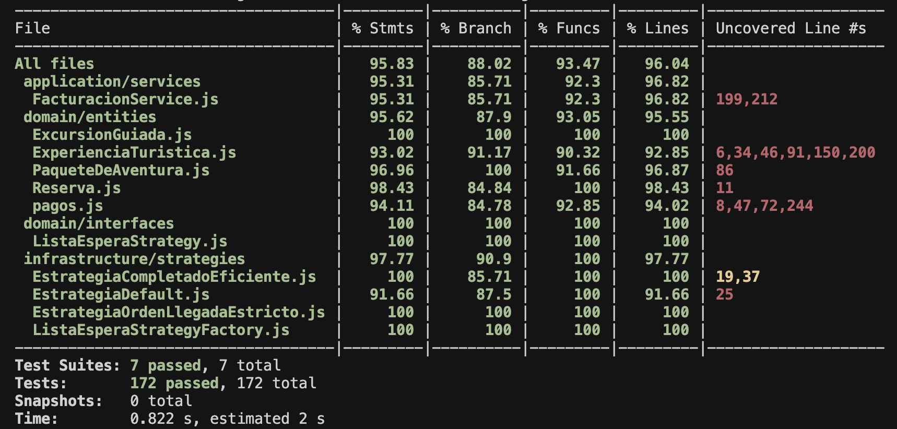
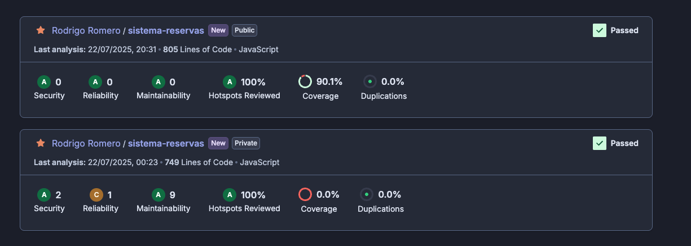

[](https://sonarcloud.io/summary/new_code?id=rromero96_tecnicas-y-herramientas-2025-MIS-TP1)

# Sistema de Gestión de Experiencias Turísticas

## Grupo 07

Integrantes del proyecto:
- Danilo Bambi
- Rodrigo Ignacio Romero

## Ejecución de Tests
```bash
npm i
npm run test:coverage
```



## Diagrama de Clases


## Descripción Funcional de las Clases

### Clases Principales

#### `ExperienciaTuristica` (Clase Abstracta)
Clase base para todas las experiencias turísticas. Gestiona aspectos comunes como disponibilidad de fechas, reservas, lista de espera y precios. Define la estructura y comportamiento básico que deben implementar sus clases hijas. Incluye la lógica para la gestión de reservas y lista de espera utilizando diferentes estrategias.

#### `ExcursionGuiada` (Extiende `ExperienciaTuristica`)
Implementa experiencias turísticas que requieren guías. Gestiona la disponibilidad considerando las fechas y el número de guías disponibles. Implementa los métodos abstractos definidos en la clase base.

#### `PaqueteDeAventura` (Extiende `ExperienciaTuristica`)
Implementa paquetes de experiencias que combinan múltiples actividades. Gestiona la disponibilidad considerando las fechas y la disponibilidad de todas las actividades incluidas. Mantiene la coherencia entre las reservas y listas de espera de todas las actividades del paquete.

#### `Reserva`
Modela una reserva para una experiencia turística. Contiene información sobre el cliente, la fecha, la cantidad de personas y la experiencia asociada. Implementa la funcionalidad para crear, cancelar y gestionar reservas.

### Estrategias de Lista de Espera

#### `EstrategiaListaEspera` (Clase Abstracta)
Define la interfaz para todas las estrategias de procesamiento de lista de espera. Declara el método abstracto `procesarListaDeEspera` que todas las estrategias concretas deben implementar.

#### `EstrategiaDefault`
Implementación básica que procesa la primera reserva de la lista de espera cuando se liberan cupos, sin consideraciones especiales.

#### `EstrategiaOrdenLlegadaEstricto`
Implementa una política estricta de "primero en llegar, primero en ser atendido". Respeta absolutamente el orden de llegada, procesando las reservas en secuencia y solo si hay suficientes cupos para cubrir completamente cada reserva. Si quedan cupos libres después de procesar una reserva, intenta procesar la siguiente recursivamente.

#### `EstrategiaCompletadoEficiente`
Implementa una estrategia que prioriza la utilización eficiente de los cupos disponibles. Busca la combinación de reservas que maximice el uso de los cupos liberados, incluso si esto significa no respetar estrictamente el orden de llegada. Primero busca coincidencias exactas (una sola reserva que llene todos los cupos), luego combinaciones de varias reservas, y si no encuentra una combinación exacta, elige la que deja menos cupos sin usar.

### Pagos y Facturación

El sistema permite registrar pagos de reservas utilizando diferentes medios de pago, cada uno con sus propias validaciones y reglas. Los medios de pago implementados actualmente son:
- **Efectivo**: Se indica el monto pagado y se calcula el vuelto.
- **Transferencia**: Se requiere el CUIT del cliente, el banco y el titular de la cuenta. Se valida el CUIT según las reglas argentinas y que el titular coincida con el cliente.

#### Validaciones y Reglas
Antes de confirmar un pago, se aplican distintas validaciones en orden (plazo, CUIT, descuentos, titular, etc.). Si alguna validación falla, el pago no se efectúa.

#### Ejemplo de uso
```js
// Registrar un pago en efectivo
facturacion.registrarPago(fecha, nombre, 'efectivo', { montoPagado: 2000 });

// Registrar un pago por transferencia
facturacion.registrarPago(fecha, nombre, 'transferencia', {
  cuit: '20329642330',
  banco: 'Banco Nación',
  titular: nombre,
  fechaPago: new Date(),
});
```

#### Extensibilidad
El sistema está preparado para agregar nuevos medios de pago (por ejemplo, tarjeta de crédito) de forma sencilla. Solo es necesario crear una nueva clase que extienda `MedioDePago` y defina su cadena de validadores.

### Patrones de Diseño en Pagos

#### Patrón Strategy
Cada medio de pago es una estrategia diferente (por ejemplo, `PagoEfectivo`, `PagoTransferencia`). Esto permite intercambiar fácilmente la lógica de pago sin modificar la clase principal de facturación.

#### Patrón Chain of Responsibility
Las validaciones de pago (plazo, CUIT, titular, etc.) se implementan como una cadena de responsabilidad. Cada validador puede aprobar o rechazar el pago y pasar al siguiente.

### Comentarios en el código
Se han agregado comentarios en español en las clases y métodos principales para facilitar la comprensión y el mantenimiento del código.

## Patrones de Diseño Implementados

### Patrón Strategy
Utilizado en la gestión de listas de espera, permitiendo intercambiar diferentes algoritmos de procesamiento sin alterar la clase cliente (`ExperienciaTuristica`). Las estrategias concretas (`EstrategiaDefault`, `EstrategiaOrdenLlegadaEstricto`, `EstrategiaCompletadoEficiente`) implementan diferentes algoritmos para la misma tarea.

### Patrón Template Method
Implementado en la clase `ExperienciaTuristica`, que define el "esqueleto" de las operaciones, dejando que las subclases (`ExcursionGuiada`, `PaqueteDeAventura`) implementen los pasos específicos. Por ejemplo, los métodos `getDisponibilidad()` y `agregarFechaEnDisponibilidad()` son abstractos en la clase base y tienen implementaciones específicas en las subclases.

### Patrón Factory Method
Utilizado en `ExperienciaTuristica` para crear e instanciar objetos de estrategia apropiados a través del método `setEstrategiaListaDeEspera()`. Crea las estrategias concretas basadas en el tipo especificado.

### Refactoring

Utilizamos la herramienta Sonar Qube para refactoring el código, eliminando los smells y errores de calidad.

A continuacion vamos a ver una foto en la que se ven los resultados del refactoring habiendo eliminado todos los smells y errores de calidad.

Entre los smells encontramos
- cognitive complexity
- duplicated code
- long method
- long parameter list
- brain method

Entre los refactorings
- extract method
- early returns
- remove parameters
- remove unused parameters




## Architectural Decision Records (ADRs)

Este proyecto documenta las decisiones arquitectónicas importantes utilizando Architectural Decision Records (ADRs). Los ADRs proporcionan un registro histórico de las decisiones de diseño, incluyendo el contexto, las opciones consideradas y las consecuencias de cada decisión.

### ADRs Documentados

Los ADRs están organizados en el directorio [`docs/decisions/`](docs/decisions/) y incluyen:

- [ADR-0000: Use Markdown Architectural Decision Records](docs/decisions/0000-use-markdown-architectural-decision-records.md)
- [ADR-0001: Adoptar Clean Architecture](docs/decisions/0001-adoptar-clean-architecture.md)
- [ADR-0002: Estructura de Capas Clean Architecture](docs/decisions/0002-estructura-de-capas-clean-architecture.md)
- [ADR-0003: Estrategia de Migración y Compatibilidad](docs/decisions/0003-estrategia-de-migracion-y-compatibilidad.md)
- [ADR-0004: Patrón Estrategia Lista Espera](docs/decisions/0004-patron-estrategia-lista-espera.md)
- [ADR-0005: Servicio Facturación](docs/decisions/0005-servicio-facturacion.md)

Para más información sobre cómo crear nuevos ADRs, consulta el [README de decisiones](docs/decisions/README.md).
